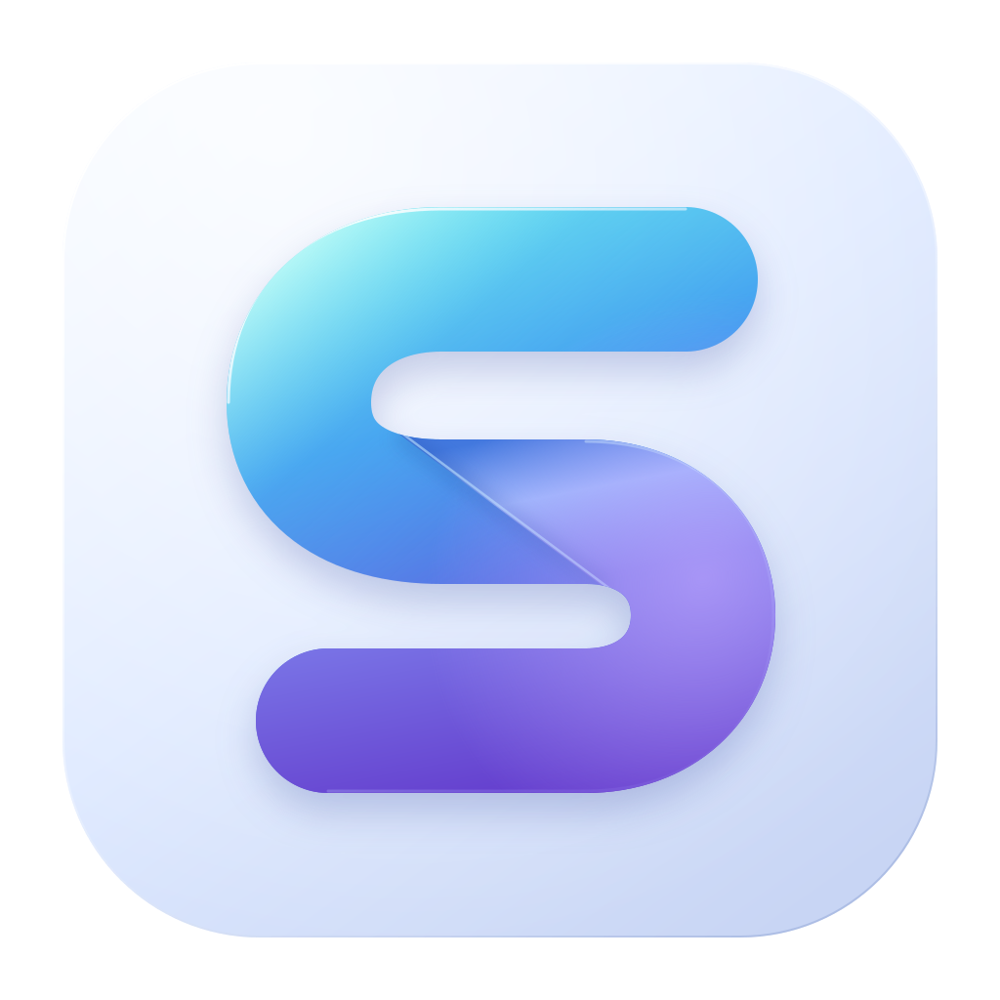

# Agent Session Manager

**English** · [简体中文](README.zh-CN.md)

A macOS app for finding AI coding sessions, switching configuration profiles, and tracking token usage.

Supports **Qoder, Claude Code, Codex, OpenCode, Pi, and Antigravity**. The interface is in Simplified Chinese.

[Download the latest release](https://github.com/yk-liang/agent-session-manager/releases/latest) · [Report an issue](https://github.com/yk-liang/agent-session-manager/issues)

## What you can do

- **Sessions (会话)** — Browse by project, search conversation text, and read messages in Markdown. Use card shortcuts to copy a resume command, resume in Terminal, or delete a session. Select multiple sessions to delete them together.
- **Configuration (配置)** — Save and switch profiles, preview changes, and restore configuration files from backups.
- **Usage (用量)** — Compare token usage by agent, model, or time range. Open a request to see its model, cache usage, timing, and recorded cost.

Configuration and usage previews

## Install

Requires **macOS 13 or later** on Apple silicon or Intel.

1. Download the `universal.dmg` from [Releases](https://github.com/yk-liang/agent-session-manager/releases/latest).
2. Open the disk image and drag **Agent Session Manager** to **Applications**. You can also extract the `.app.zip` and move the app there.
3. To update, quit the app and replace it with the new version.

The release is not notarized by Apple. If macOS blocks the first launch, verify the download source before allowing the app to open. [Apple’s instructions for opening an app from a known source](https://support.apple.com/en-us/102445)

## Sessions and data

Use a supported agent to create a local session, then select that agent in the app. First-time usage sync can take a few minutes. You can keep using the app while it runs.

- To resume or fork a session in Terminal, install the corresponding CLI. Antigravity CLI sessions resume with `agy`. Forking is available for select agents.
- Use **显示已归档 (Show Archived)** to browse archived Codex sessions. Session actions use the local Codex App Server available with the desktop app, VS Code extension, or CLI.
- Deleting a session usually moves it to the Trash. Codex and OpenCode delete sessions permanently. Antigravity sessions are read-only in the app.
- Usage is based on local logs. The app retains synced usage after you delete a session and displays costs recorded in the logs. Usage syncs automatically while the app is running.

Where is my data?

Use **打开数据目录 (Open Data Folder)** in the toolbar. If the list is empty, check that the agent has saved a session in a location the app can read.

| Agent | Default locations |
| --- | --- |
| Qoder | `~/.qoder/projects/` |
| Claude Code | `~/.claude/projects/` |
| Codex | `~/.codex/sessions/`, `~/.codex/archived_sessions/` |
| OpenCode | `~/.local/share/opencode/` |
| Pi | `~/.pi/agent/sessions/` |
| Antigravity | `~/.gemini/antigravity*/conversations/`, `~/.config/antigravity/conversations/` |

Use `ANTIGRAVITY_DATA_DIR` for custom Antigravity locations. Separate multiple data or conversation directories with commas.

Codex usage includes archived logs.

The app stores synced usage in `~/Library/Application Support/Agent Session Manager/` and configuration profiles and backups in `~/.agent-session-manager/`.

## Feedback and contributions

Include the app version, agent version, and steps to reproduce when filing an [issue](https://github.com/yk-liang/agent-session-manager/issues). For read or sync errors, use **复制诊断详情 (Copy Diagnostics)**. Review paths and other private information before sharing.

See the [development guide](docs/DEVELOPMENT.md) for build and test instructions in Chinese.

## License

[MIT](LICENSE). Thanks to [agent-session-cleaner](https://github.com/haowang02/agent-session-cleaner), [ccusage](https://github.com/ccusage/ccusage), and [agent-events](https://github.com/haowang02/agent-events) for their work. See the [third-party licenses](public/licenses).
