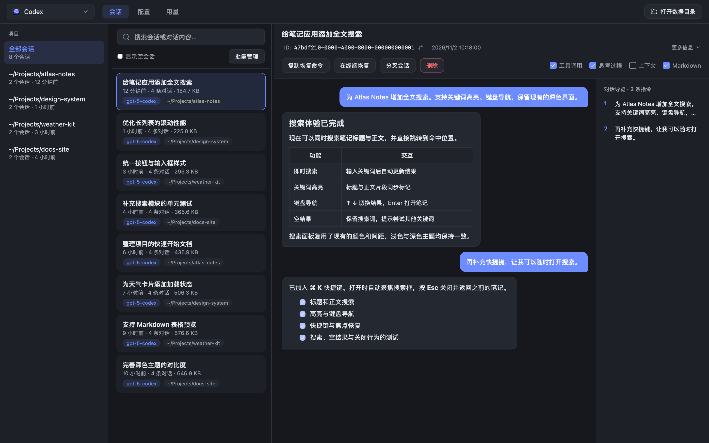
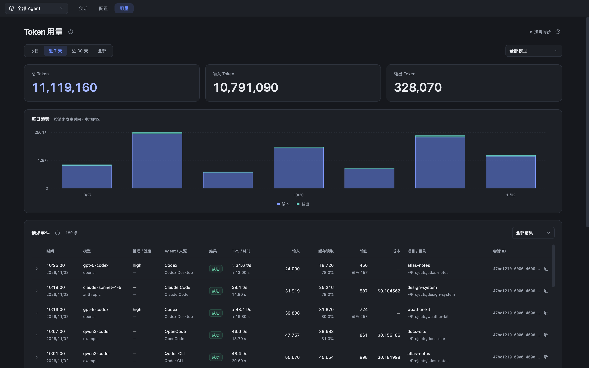
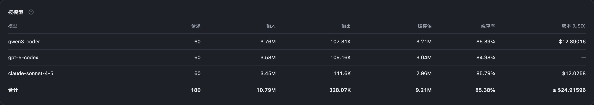
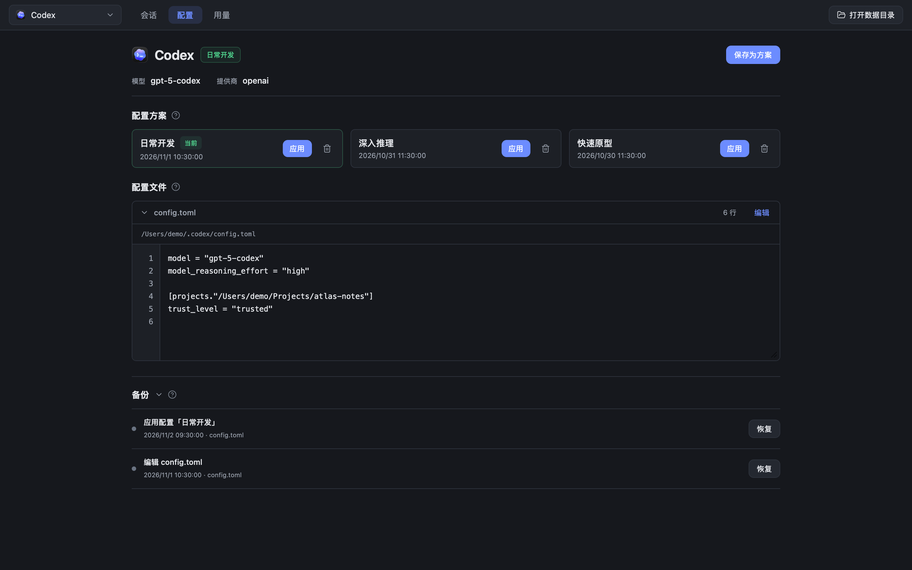

# Agent Session Manager

**English** · [简体中文](README.zh-CN.md)

Find past AI coding sessions, switch configurations, and track token usage in one macOS app.

Supports **Qoder CLI, Claude Code, Codex, OpenCode, and Pi**.

[Download the latest release](https://github.com/yk-liang/agent-session-manager/releases/latest) · [Report an issue](https://github.com/yk-liang/agent-session-manager/issues)

## Features

Screenshots show the current source build with fictional projects, conversations, and usage data. The app interface is currently in Chinese.

### Find a session and pick up where you left off

- Browse by Agent and project. Search session titles and conversation text.
- Read Markdown and jump between messages with the conversation outline. System prompts and injected context are hidden by default; tool calls and reasoning can be expanded.
- Copy a resume command or continue in a terminal. Delete sessions in bulk and fork sessions for supported Agents.

Codex support includes local sessions from the CLI, IDE integrations, and desktop app. OpenCode supports both v1 and v2 data formats.

### Understand usage, down to each request

- Filter by Agent, model, and date range. View hourly trends for today and daily trends for the last 7 or 30 days.
- Inspect each request's model, tokens, cache usage, TPS, duration, project, and source. Browse numbered pages and filter by outcome.
- Keep usage history locally, even after deleting the original session. During the first sync, incomplete totals are clearly labeled.

Compare request counts, input and output tokens, cache reads, cache hit rates, and recorded costs by model:

### Manage configuration profiles

Save multiple profiles and preview changes before switching. Files are backed up before changes and can be restored. Edit configuration files directly, with format validation and checks for external changes.

## Install and update

**macOS 13 or later, on Apple Silicon or Intel.** The desktop app does not require Node.js or ccusage.

1. Download the installer whose name ends in `universal.dmg` from [Releases](https://github.com/yk-liang/agent-session-manager/releases/latest).
2. Open it and drag **Agent Session Manager** into **Applications**. Alternatively, download the `.app.zip`, extract it, and move the app there.
3. To update, quit the old version and replace the app. Sessions, configurations, and saved usage are stored outside the app bundle.

Current releases are not notarized by Apple. If macOS blocks the first launch, verify the download source and follow [Apple's instructions](https://support.apple.com/en-us/102445) to select **Open Anyway** in **System Settings → Privacy & Security**. Releases include SHA-256 checksums.

Resuming or forking sessions in a terminal, and deleting OpenCode sessions, require the corresponding Agent CLI to be installed.

## Get started

1. Use any supported Agent first so that local session logs exist.
2. Open the app, choose an Agent in the toolbar, and switch between **会话 (Sessions) / 配置 (Configuration) / 用量 (Usage)**. The Usage tab also offers **全部 Agent (All Agents)**.
3. Importing a large history for the first time may take a few minutes. You can use other pages while it runs. Updates happen automatically.

After saving a configuration, whether the Agent needs a restart depends on how that Agent reloads its settings.

## Usage and data

- **Local logs, not provider billing.** Cache hit rate is cache reads ÷ input tokens. Cache and reasoning are breakdowns, not additional tokens added to the total. TPS is output tokens ÷ request duration, which may include waiting time.
- **Missing does not mean zero.** `—` means unrecorded, `≈` means estimated, and `≥` marks a known lower bound. Costs are shown only when the logs provide a USD amount.
- **Saved history stays available.** Current releases sync while the app is in use, not after it quits. Records deleted externally before they were synced cannot be recovered.
- **Deleting a session affects the original data.** Most sessions go to the system Trash. OpenCode sessions are permanently deleted through its official CLI and cannot be restored by this app.

Where is my data? Why are no sessions showing?

The app reads existing local Agent data. If no sessions appear, check that the Agent has written session logs. If you use a custom directory, the app needs access to it.

| Agent | Common data locations |
| --- | --- |
| Qoder CLI | `~/.qoder/projects/` |
| Claude Code | `~/.claude/projects/` |
| Codex | `~/.codex/sessions/`, `~/.codex/archived_sessions/` |
| OpenCode | `~/.local/share/opencode/` |
| Pi | `~/.pi/agent/sessions/` |

Saved usage lives in `~/Library/Application Support/Agent Session Manager/`. Configuration profiles and backups live in `~/.agent-session-manager/`. Quit the app before backing up these complete directories; if you use a build with background collection enabled, disable it first. Original sessions remain managed by each Agent.

## Feedback and contributions

Please include the app version, Agent version, and reproduction steps when opening an [issue](https://github.com/yk-liang/agent-session-manager/issues). Remove keys, private paths, and conversation content before sharing screenshots or logs.

See the [development guide](docs/DEVELOPMENT.md) (Chinese) for building, testing, and regenerating screenshots.

## License and acknowledgments

[MIT](LICENSE). Thanks to [agent-session-cleaner](https://github.com/haowang02/agent-session-cleaner), [ccusage](https://github.com/ccusage/ccusage), and [agent-events](https://github.com/haowang02/agent-events) for reference implementations. See [public/licenses](public/licenses) for third-party licenses. Agent logos belong to their respective owners.
