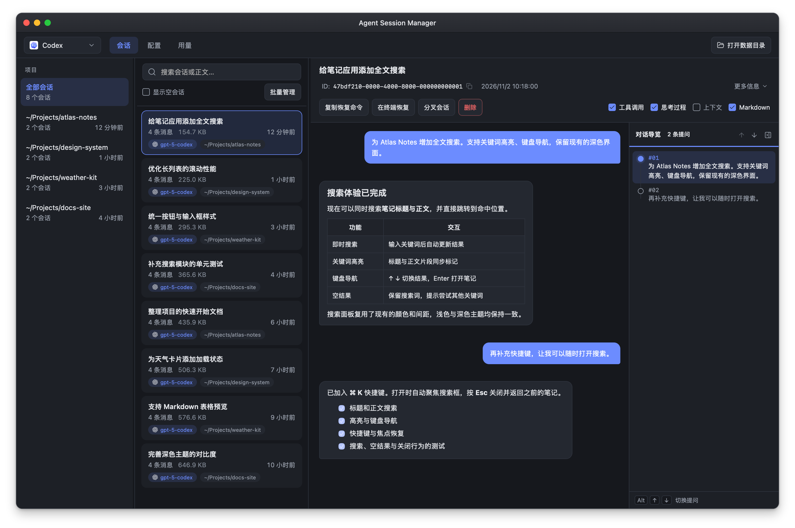
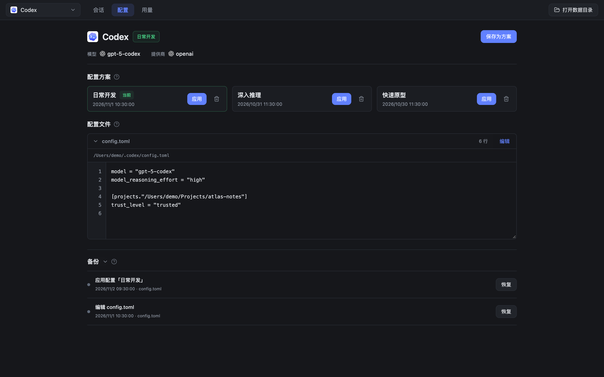
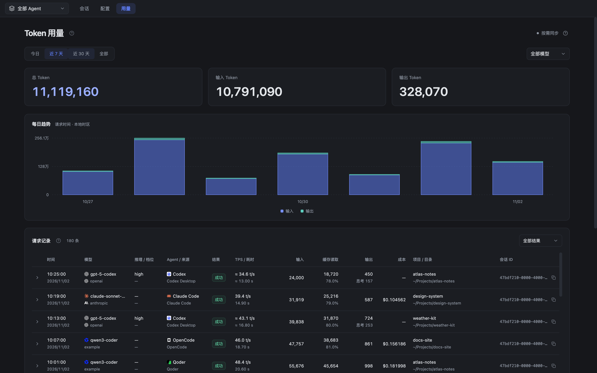

  <strong>English</strong> · <a href="README.zh-CN.md">简体中文</a>

  

<h1 align="center">Agent Session Manager</h1>

  Browse local AI coding sessions, manage configuration profiles, and track usage on macOS.

  

- **Sessions (会话)** — Browse by project or search messages. Read conversations in Markdown, jump between prompts, or resume in Terminal.
- **Configuration (配置)** — Save profiles, preview changes before applying them, and restore backups.
- **Usage (用量)** — Compare token usage, request counts, and estimated costs. Inspect individual requests and set custom model prices.

Configuration and usage screenshots

## Install

Requires **macOS 13 or later** on Apple silicon or Intel. Download the universal DMG, open it, and drag **Agent Session Manager** to **Applications**. To update, quit the app before replacing it. [Releases](https://github.com/yk-liang/agent-session-manager/releases/latest)

Apple has not notarized the release. If macOS blocks the first launch, verify the download source before allowing the app to open. [Apple’s instructions](https://support.apple.com/en-us/102445)

## Using the app

- Select an agent to browse its local sessions. Turn on **显示已归档 (Show Archived)** to see archived Codex and OpenCode sessions. The app can archive and unarchive Codex sessions. Resuming in Terminal requires the agent’s command-line tool.
- Deleting a Codex or OpenCode session is permanent. Other deletable sessions go to the Trash. Antigravity sessions are read-only.
- The app syncs usage while it is open. The first sync may take a few minutes. Synced usage remains available after a session is deleted.

## Help and development

Include the app version, agent version, and steps to reproduce when reporting a problem. If you include diagnostics, review any local paths before sharing them. [Report an issue](https://github.com/yk-liang/agent-session-manager/issues)

For data locations, build instructions, and tests, see the [development guide](docs/DEVELOPMENT.md).

## License

[MIT](LICENSE). Agent Session Manager draws on work from [agent-session-cleaner](https://github.com/haowang02/agent-session-cleaner), [ccusage](https://github.com/ccusage/ccusage), and [agent-events](https://github.com/haowang02/agent-events). See the [third-party licenses](public/licenses).
