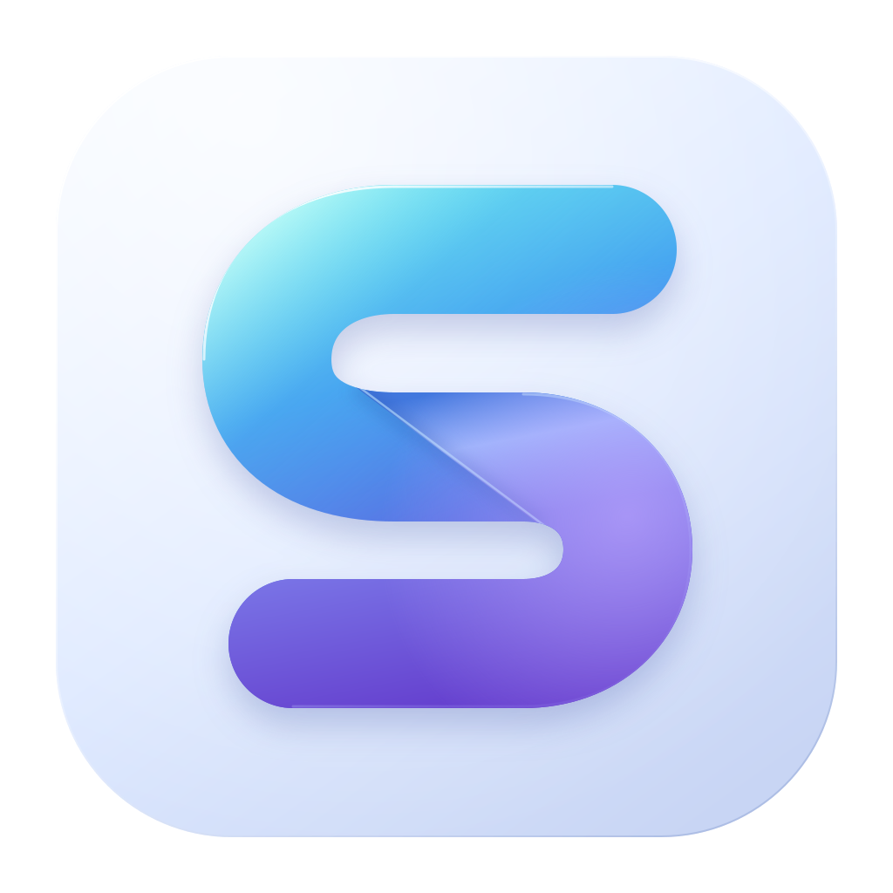
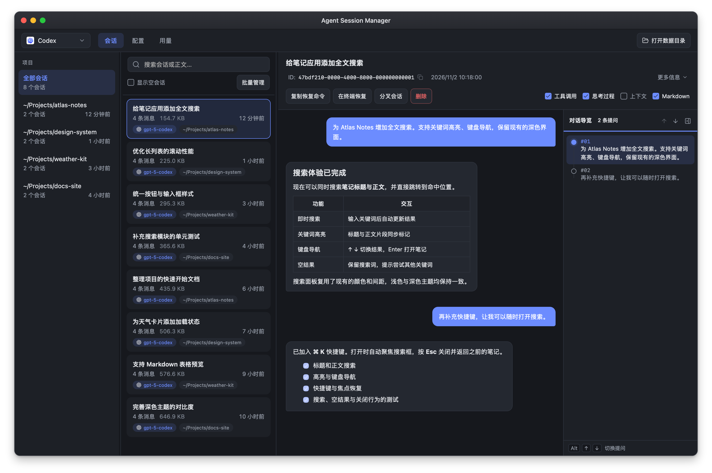
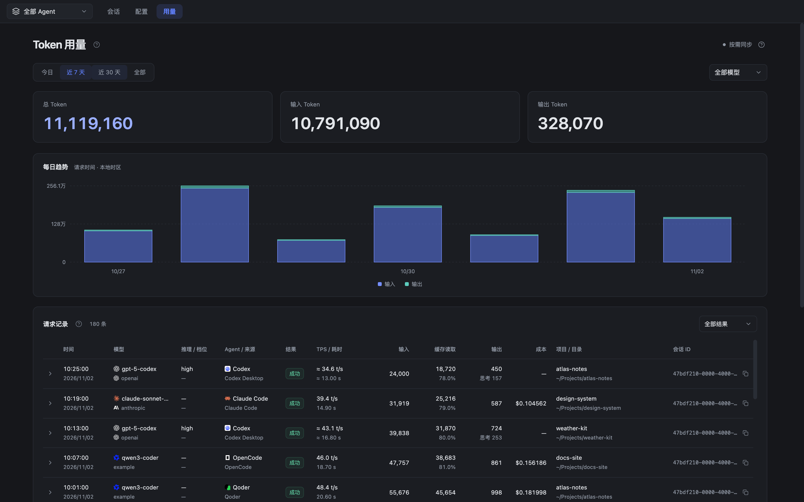
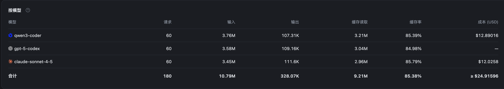

# Agent Session Manager

[English](README.md) · **简体中文**

在 macOS 上查找 AI 编程会话、切换配置方案、查看 Token 用量。

支持 **Qoder、Claude Code、Codex、OpenCode、Pi 和 Antigravity**。界面使用简体中文。

[下载最新版本](https://github.com/yk-liang/agent-session-manager/releases/latest) · [反馈问题](https://github.com/yk-liang/agent-session-manager/issues)

## 主要功能

- 在**会话**页按项目浏览会话、搜索正文、阅读 Markdown 消息。通过卡片快捷操作复制恢复命令、在终端恢复或删除会话，也可批量删除。
- 在**配置**页保存和切换方案、预览差异、恢复备份。
- 在**用量**页按 Agent、模型和时段比较 Token 用量，展开请求可查看模型、缓存、耗时和成本。

查看配置和用量截图

## 安装

支持 **macOS 13 及以上版本**，适用于 Apple 芯片和 Intel 芯片的 Mac。

1. 在[发布页](https://github.com/yk-liang/agent-session-manager/releases/latest)下载 `universal.dmg` 安装包。
2. 打开磁盘映像，将 **Agent Session Manager** 拖到「应用程序」。也可以下载 `.app.zip`，解压后移动应用。
3. 更新时，先退出应用，再替换旧版。

发行包未经 Apple 公证。如果 macOS 阻止首次启动，请先确认下载来源，再允许打开。[Apple 官方说明](https://support.apple.com/zh-cn/102445)

## 会话与数据

先使用支持的 Agent 生成本机会话，再在应用中选择对应的 Agent。首次同步用量可能需要几分钟，期间可继续使用应用。

- 在终端恢复或分叉会话需要安装对应的 CLI。Antigravity CLI 会话通过 `agy` 恢复。分叉功能因 Agent 而异。
- 勾选「显示已归档」可查看已归档的 Codex 会话。会话操作使用本机 Codex App Server，可由桌面应用、VS Code 扩展或 CLI 提供。
- 删除会话通常会将文件移入废纸篓。Codex 和 OpenCode 会永久删除会话。Antigravity 会话在应用中为只读。
- 用量来自本地日志。删除会话后，已同步的用量仍可查看。应用运行时会自动同步，成本以日志记录为准。

数据在哪里？

可从顶栏选择「打开数据目录」。如果列表为空，请确认 Agent 已保存本机会话，并且应用可以读取该目录。

| Agent | 默认位置 |
| --- | --- |
| Qoder | `~/.qoder/projects/` |
| Claude Code | `~/.claude/projects/` |
| Codex | `~/.codex/sessions/`、`~/.codex/archived_sessions/` |
| OpenCode | `~/.local/share/opencode/` |
| Pi | `~/.pi/agent/sessions/` |
| Antigravity | `~/.gemini/antigravity*/conversations/`、`~/.config/antigravity/conversations/` |

使用 `ANTIGRAVITY_DATA_DIR` 指定 Antigravity 的数据目录或会话目录，多个目录用逗号分隔。

Codex 的归档日志也计入用量统计。

已同步的用量保存在 `~/Library/Application Support/Agent Session Manager/`，配置方案和备份保存在 `~/.agent-session-manager/`。

## 反馈与贡献

提交 [Issue](https://github.com/yk-liang/agent-session-manager/issues)时，请附上应用版本、Agent 版本和复现步骤。读取或同步失败时可选择「复制诊断详情」。分享前请检查本机路径等私密信息。

构建与测试说明见[开发文档](docs/DEVELOPMENT.md)。

## 许可证

[MIT](LICENSE)。感谢 [agent-session-cleaner](https://github.com/haowang02/agent-session-cleaner)、[ccusage](https://github.com/ccusage/ccusage) 和 [agent-events](https://github.com/haowang02/agent-events) 提供参考。其他项目与资源的许可见[第三方许可证](public/licenses)。
