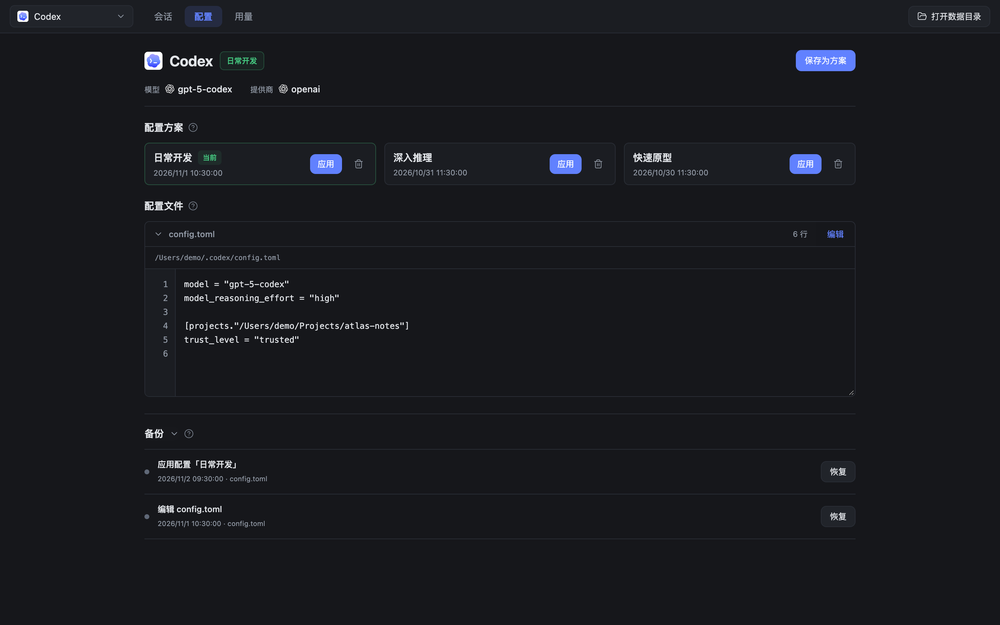

  <a href="README.md">English</a> · <strong>简体中文</strong>

  

<h1 align="center">Agent Session Manager</h1>

  在 macOS 上浏览本地 AI 编程会话、管理配置方案、查看用量。

  

- **会话**可按项目浏览，也可搜索消息。支持 Markdown、对话导览和在终端恢复会话。
- **配置**可保存方案、预览应用方案后的变更、恢复备份。
- **用量**可比较 Token 用量、请求次数和估算费用，也可查看单次请求、设置自定义模型价格。

配置和用量截图

## 安装

支持 **macOS 13 或更高版本**，兼容 Apple 芯片和 Intel 芯片。下载并打开通用 DMG，将 **Agent Session Manager** 拖入「应用程序」。更新时先退出应用，再替换旧版。[发布页](https://github.com/yk-liang/agent-session-manager/releases/latest)

安装包未经 Apple 公证。如果 macOS 阻止首次启动，请确认下载来源后再允许打开。[Apple 官方说明](https://support.apple.com/zh-cn/102445)

## 使用说明

- 选择 Agent 查看本机会话。勾选「显示已归档」可查看 Codex 和 OpenCode 的归档会话。应用支持归档和取消归档 Codex 会话。在终端恢复会话需要对应的命令行工具。
- Codex 和 OpenCode 会话会永久删除，其他可删除的会话会移入废纸篓。Antigravity 会话为只读。
- 应用打开期间会自动同步用量。首次同步可能需要几分钟。删除会话后，已同步的用量仍可查看。

## 反馈与开发

反馈问题时请附上应用版本、Agent 版本和复现步骤。如果附上诊断详情，请先检查其中的本机路径。[反馈问题](https://github.com/yk-liang/agent-session-manager/issues)

数据目录、构建与测试说明见[开发文档](docs/DEVELOPMENT.md)。

## 许可证

[MIT](LICENSE)。本项目参考了 [agent-session-cleaner](https://github.com/haowang02/agent-session-cleaner)、[ccusage](https://github.com/ccusage/ccusage) 和 [agent-events](https://github.com/haowang02/agent-events)。其他许可见[第三方许可证](public/licenses)。
