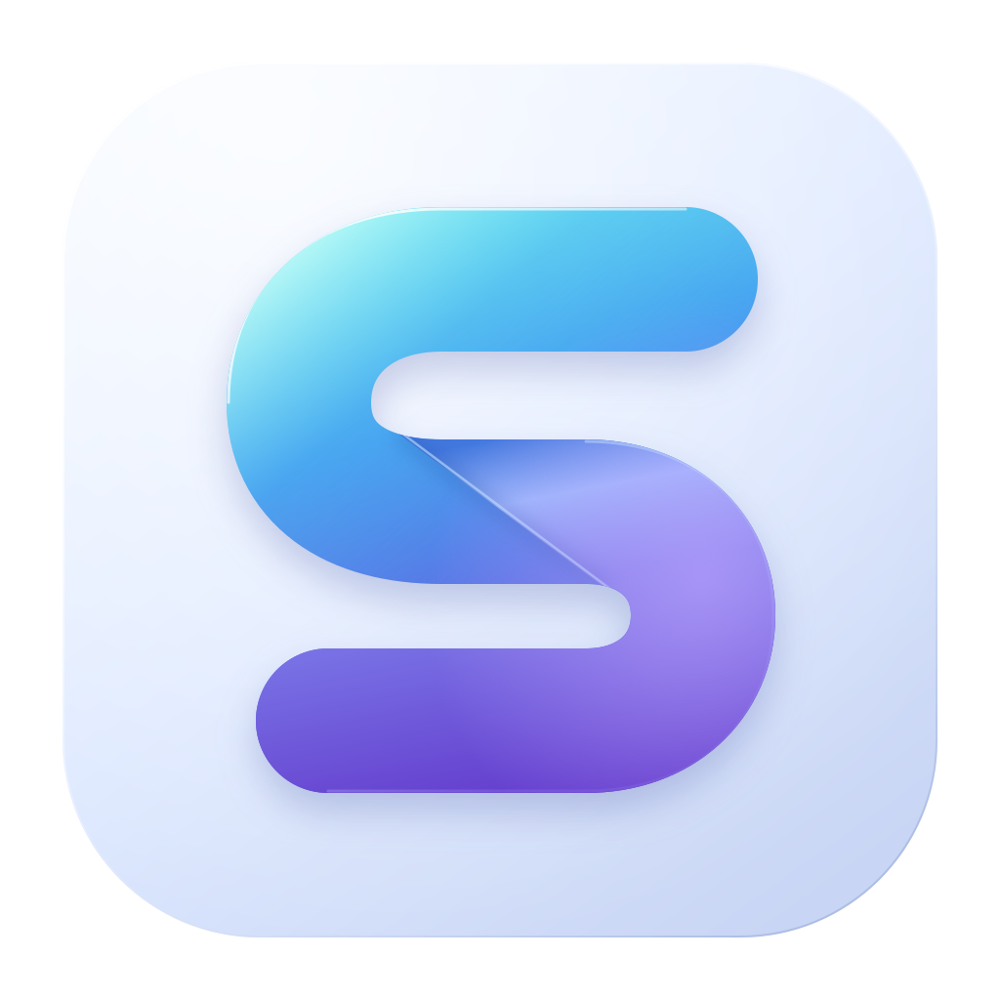
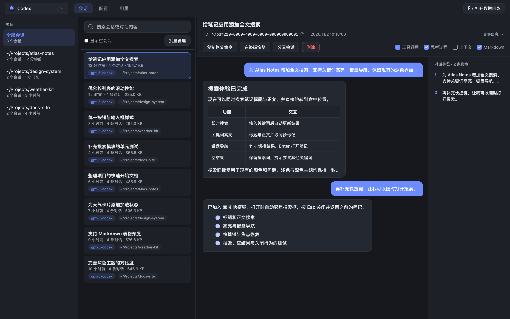
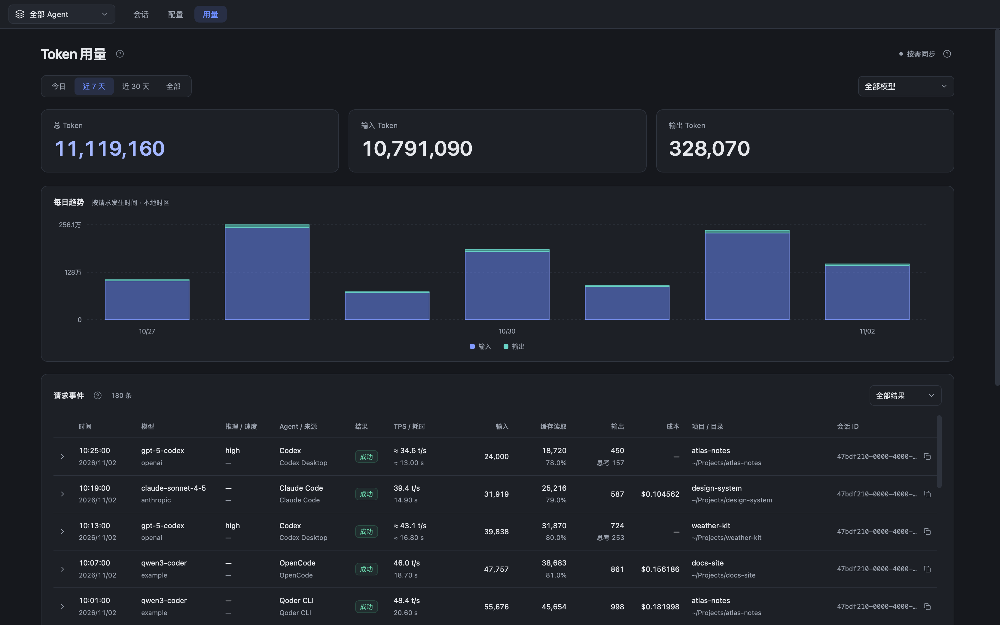
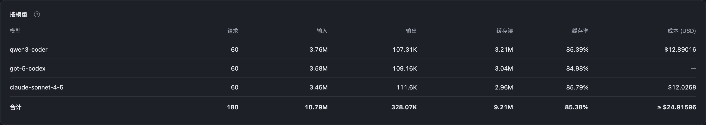
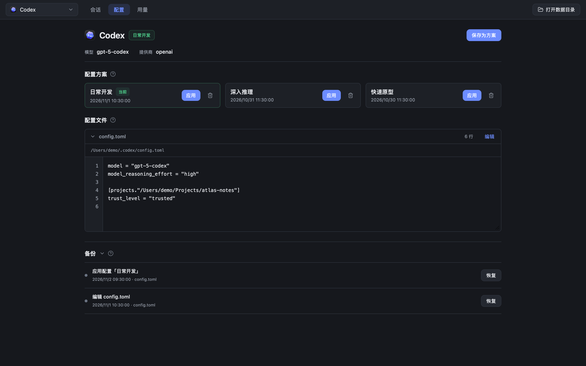

# Agent Session Manager

[English](README.md) · **简体中文**

在一个 macOS 应用里，找回 AI 编程会话、切换配置、查看 Token 用量。

支持 **Qoder CLI、Claude Code、Codex、OpenCode 和 Pi**。

[下载最新版本](https://github.com/yk-liang/agent-session-manager/releases/latest) · [反馈问题](https://github.com/yk-liang/agent-session-manager/issues)

## 功能预览

以下截图使用虚构的项目、对话和用量数据，展示当前源码的界面。应用目前使用中文界面。

### 找到会话，继续工作

- 按 Agent 和项目浏览，搜索会话标题与对话正文。
- 阅读 Markdown、通过对话导览跳转；系统提示词与上下文默认隐藏，工具调用和思考过程可展开查看。
- 复制恢复命令或在终端继续会话；支持批量删除，以及部分 Agent 的会话分叉。

Codex 支持 CLI、IDE 与桌面应用生成的本地会话；OpenCode 兼容 v1 和 v2 数据格式。

### 看懂用量与每次请求

- 按 Agent、模型和时间筛选；今日按小时绘图，近 7 天和近 30 天按日绘图。
- 查看请求的模型、Token、缓存、TPS、耗时、所属项目及来源，支持分页与结果筛选。
- 用量在本地保存，删除原会话后仍可查询。首次同步未完成时，明确标注已统计部分。

按模型比较请求数、输入输出、缓存读取、缓存率和日志中记录的成本：

### 管理配置方案

保存多套配置，切换前预览差异；修改前自动备份，需要时可恢复。支持直接编辑配置文件，并检查格式与外部修改冲突。

## 安装与更新

**macOS 13+，支持 Apple Silicon 与 Intel。** 图形应用不需要 Node.js 或 ccusage。

1. 在 [Releases](https://github.com/yk-liang/agent-session-manager/releases/latest) 下载文件名以 `universal.dmg` 结尾的安装包。
2. 打开 DMG，将 **Agent Session Manager** 拖入 **Applications**。也可下载 `.app.zip`，解压后移动应用。
3. 更新时先退出旧版，再替换应用；会话、配置和已保存用量不在应用包内。

当前发行版未经过 Apple 公证。首次打开若被阻止，确认下载来源后，按 [Apple 官方步骤](https://support.apple.com/zh-cn/102445) 在“系统设置 → 隐私与安全性”中选择“仍要打开”。Release 附有 SHA-256 校验文件。

在终端恢复、分叉会话，以及删除 OpenCode 会话，需要安装对应的 Agent CLI。

## 开始使用

1. 先使用任一支持的 Agent，确保本机已有会话记录。
2. 打开应用，在顶栏选择 Agent，切换 **会话 / 配置 / 用量**；用量页可选择 **全部 Agent**。
3. 首次读取大量历史可能需要几分钟，期间可继续使用其他页面。应用会自动更新，无需手动刷新。

配置保存后，相关 Agent 是否需要重启，取决于它自身的配置加载方式。

## 用量与数据

- **统计来自本地日志，不是服务商账单。** 缓存率为缓存读取 ÷ 输入；缓存与思考属于细分，不重复加入总 Token。TPS 按输出 Token ÷ 请求耗时计算，可能包含等待时间。
- **缺失值不会当作零。** `—` 表示未记录，`≈` 表示估算，`≥` 表示已记录的下限。成本仅显示日志提供的美元金额。
- **保留已保存的历史。** 当前发行版在使用时自动同步，退出后不采集。外部删除前尚未同步的记录无法恢复。
- **删除会影响原始会话。** 普通会话移入系统回收站；OpenCode 通过官方 CLI 永久删除，无法通过本应用恢复。

数据在哪里？为什么没有看到会话？

应用读取各 Agent 已有的本地数据。没有会话时，请确认对应 Agent 已生成日志；使用自定义目录时，应用需要能访问该目录。

| Agent | 常见数据位置 |
| --- | --- |
| Qoder CLI | `~/.qoder/projects/` |
| Claude Code | `~/.claude/projects/` |
| Codex | `~/.codex/sessions/`、`~/.codex/archived_sessions/` |
| OpenCode | `~/.local/share/opencode/` |
| Pi | `~/.pi/agent/sessions/` |

已保存用量位于 `~/Library/Application Support/Agent Session Manager/`；配置方案与备份位于 `~/.agent-session-manager/`。退出应用后可备份这些完整目录；如果使用了支持后台采集的构建，请先关闭后台采集。原始会话仍由各 Agent 管理。

## 反馈与贡献

欢迎提交 [Issue](https://github.com/yk-liang/agent-session-manager/issues)，附上应用版本、Agent 版本与复现步骤。分享截图或日志前，请移除密钥、私人路径和对话内容。

构建、测试与截图生成方法见 [开发文档](docs/DEVELOPMENT.md)。

## 许可与致谢

[MIT](LICENSE)。感谢 [agent-session-cleaner](https://github.com/haowang02/agent-session-cleaner)、[ccusage](https://github.com/ccusage/ccusage) 和 [agent-events](https://github.com/haowang02/agent-events) 提供参考。第三方许可见 [public/licenses](public/licenses)，各 Agent 标识归其权利人所有。
